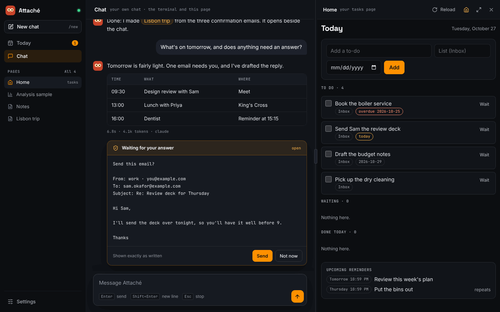

# Attaché

A personal assistant you install with one command. It runs on your own machine, keeps your
to-dos and reminders, makes interactive pages on demand, and learns how you work through a
folder of skills it can edit itself. The core is under 2,710 lines of Python code, the cap
CI enforces; everything else is a skill.

> **Status:** phase 3 of the [roadmap](docs/proposal.html): the local core, terminal and web
> chat; Slack and Signal with group chats, approvals and rate limits; email (Outlook, Gmail,
> Titan) with a morning triage; email requests from people you list, for your free slots or a
> job you defined; Word, Excel and PowerPoint files; share links; and starting at login. The
> cloud arrives in phase 4.

**Documentation:** <https://openafterhours.github.io/attache/>.

## Try it

```
uvx attache              # first run asks your name, creates ~/.attache, then opens a chat
uv tool install attache  # keep it
attache chat             # terminal chat, plus the web page
attache run              # web page, reminders and channels, no terminal chat
attache doctor           # check your setup
attache skill mail login gmail   # a skill's own setup step, run in your terminal
attache skill service install    # start Attaché when you log in
attache skill tui                # a full-screen terminal app (docs/terminal.md)
```

While a turn runs, the terminal shows what Attaché is doing: `working…`, each step with its
time, a line of Claude's thinking, and a footer with time and tokens. Ctrl+C stops a turn.



The terminal and the web page are one conversation. Attaché prints a link like
`http://127.0.0.1:8765/#t=...` when it starts; open that link to use the web page. The token in
it changes every run, so other programs on your machine can't drive your assistant.

The [web workspace](docs/workspace.md) has Chat, Split and Workspace layouts with a
resizable divider. Switch between tasks, saved pages, activity and owner-only Settings;
your draft and open pages stay in place. Settings validates and previews changes before
saving, preserves file-managed options, and shows when a restart is needed.

The optional [analysis skill](docs/analysis.md) connects the same conversation to a Hailer
notebook. Saved result pages appear in the workspace; the live notebook opens separately.

Attaché talks to models through four adapters, chosen in `~/.attache/attache.toml`:

| `api`              | Use it for                                                        |
|--------------------|-------------------------------------------------------------------|
| `claude-cli`       | Claude Code (`claude -p`) on your own login. Your own chats only. |
| `anthropic`        | The Claude API, or any Anthropic-compatible `base_url`            |
| `openai-chat`      | Ollama, LM Studio, vLLM, llama.cpp, OpenRouter, Groq, Azure       |
| `openai-responses` | OpenAI reasoning models with tools                                |

```toml
[routing]
own_chats   = "claude"      # your Claude login
group_chats = "claude-api"  # an API key, per Anthropic's terms

[endpoints.claude]
api   = "claude-cli"
model = "claude-sonnet-5-5"

[endpoints.claude-api]
api     = "anthropic"
model   = "claude-sonnet-5-5"
key_env = "ANTHROPIC_API_KEY"
```

## How it is put together

- **Skills** live in `~/.attache/skills/<name>/SKILL.md` ([Agent Skills](https://agentskills.io)
  format). Only names and descriptions go into the prompt. The assistant edits skills when you
  change how you work, and `~/.attache` is a git repo, so `attache skills log` and
  `attache skills undo <name>` show and reverse every change.
- **Artifacts** are HTML pages the assistant writes into `~/.attache/artifacts/`. The local web
  server adds a small `attache` bridge so a page can read and write real data with live updates.
  Pages run sandboxed: they can't reach the internet or anything outside the data they declare.
- **Channels.** Slack and Signal are skills that ship a small program, a sidecar, which Attaché
  starts with `uv run` and talks to over JSON lines. Any chat app can be added the same way:
  see [docs/channels.md](docs/channels.md).
- **Mail** is one skill with the same commands for Outlook (Outlook classic on this PC, or
  Microsoft Graph), Gmail and Titan. Bodies come back marked untrusted, every action is logged,
  and nothing is sent until you pick Send: see [docs/mail.md](docs/mail.md).
- **Email requests.** People you list can write `@attache` in an email to you. Attaché checks
  the message really came from them (DMARC), then answers in the thread: free slots from your
  diary, never what is in it ([docs/diary.md](docs/diary.md)), or a job you defined, run in the
  background, with "done" or "failed" back to them and the details to you
  ([docs/jobs.md](docs/jobs.md)). Setup is in [docs/channels.md](docs/channels.md).
- **The web.** The `web` skill searches (DuckDuckGo, or Brave with a key) and reads pages as
  text, for you and your group chats, and reaches only the public internet, never your own
  machine or network: see [docs/web.md](docs/web.md). The `browser` skill drives Edge or
  Chrome with your sign-in to read the work sites you list, such as SharePoint and Power BI,
  for you alone: see [docs/browser.md](docs/browser.md).
- **Share links.** With `[web] public_url` set and Tailscale Funnel pointed at a second local
  port, a group's page gets a link that works on anyone's phone, for that group's shared data
  only: see [docs/pages.md](docs/pages.md).
- **Roles.** You are the owner. Group members only reach what is shared with their chat, and
  never files, shell or email. Your own turns inside a group get member tools too, because the
  group's messages are untrusted. When a member asks for something only you can do, Attaché
  asks you first (buttons on Slack and the web page, a reaction or a typed reply elsewhere).
- **Claude Code** runs as a backend with `claude -p` on your own login, for your own chats only.
  Attaché's tools reach it through an MCP endpoint on the local web server. It runs in a
  working folder next to your home (`~/.attache-claude`), so nothing written into `~/.attache`
  can load as Claude Code project settings.

The full design, with the research behind it, is in [docs/proposal.html](docs/proposal.html).

## Contributing

See [CONTRIBUTING.md](CONTRIBUTING.md): bug fixes and simplifications go in the core, features
go in skills.

## License

MIT
