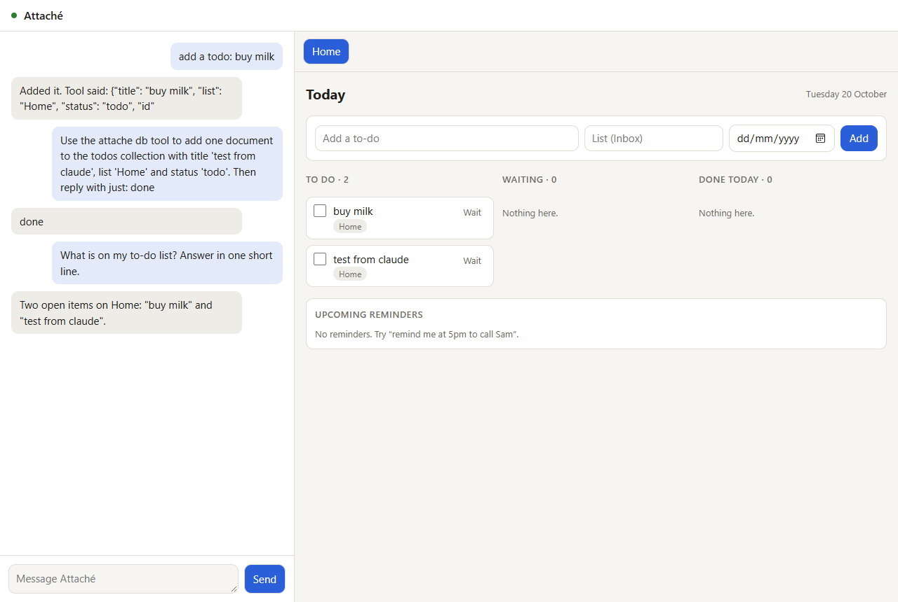

# Attaché

A personal assistant you install with one command. It runs on your own machine, keeps your
to-dos and reminders, makes interactive pages on demand, and learns how you work through a
folder of skills it can edit itself. The core is under 2,700 lines of Python, a cap that CI
enforces. Everything else is a skill.

```bash
uvx attache                  # try it without installing
uv tool install attache      # keep it
attache init && attache run  # set up ~/.attache, then start the web page
```

{ .oah-shot }

You chat with Attaché in a terminal and on a local web page, and both are the same
conversation. Ask it for a to-do, a reminder or a board, and the Home page updates while you
watch. Tell it how you like things done and it writes that into a skill, which you can read,
change, and undo with one command.

!!! note "Phase 1"

    This release is the local core: terminal and web chat, to-dos, reminders, pages and
    skills. Slack and Signal arrive in phase 2, and email (Outlook, Gmail, Titan) in phase 3.
    See [Design and roadmap](design.md).

## Where to start

<div class="grid cards" markdown>

-   :lucide-rocket:{ .lg .middle } **Quickstart**

    ---

    Install Attaché, set up your home folder, open the web page and have a first chat.

    [:lucide-arrow-right: Get started](quickstart.md)

-   :lucide-settings:{ .lg .middle } **Configuration**

    ---

    Pick the models for your own chats and for group chats: Claude Code, the Claude API,
    OpenAI, or a local model through Ollama.

    [:lucide-arrow-right: attache.toml](configuration.md)

-   :lucide-book-open:{ .lg .middle } **Skills**

    ---

    The folder of know-how that Attaché reads and rewrites, with a git history you can
    browse and undo.

    [:lucide-arrow-right: Skills](skills.md)

-   :lucide-layout-dashboard:{ .lg .middle } **Pages**

    ---

    Interactive HTML pages over your real data, kept live by a small bridge, and
    sandboxed in the Attaché window.

    [:lucide-arrow-right: Pages](pages.md)

-   :lucide-shield-check:{ .lg .middle } **Security**

    ---

    Who can do what, how pages are sandboxed, and what the Claude Code backend may do on
    your behalf.

    [:lucide-arrow-right: Security](security.md)

-   :lucide-map:{ .lg .middle } **Design and roadmap**

    ---

    The full design proposal, the research behind it, and the four phases.

    [:lucide-arrow-right: Design](design.md)

</div>

Want to help? Bug fixes and simplifications go in the core, and features go in skills. See
[Contributing](developers/contributing.md).
