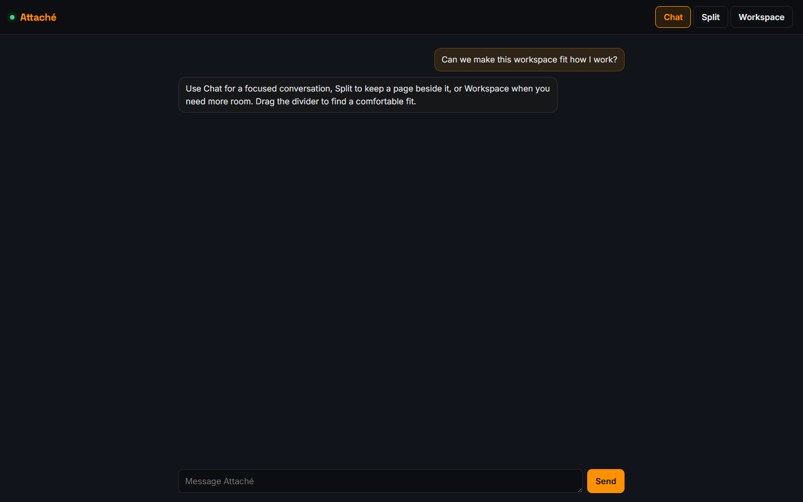

# Web workspace

The web page and terminal share your conversation. Open the link Attaché prints when it
starts, then choose how much room to give the conversation and the work beside it.

## Layout

- **Chat** gives the conversation the whole page, with a centred reading column.
- **Split** shows chat beside the workspace. Drag the divider to resize the two panes, or
  focus it and use the left and right arrow keys.
- **Workspace** gives the selected view the whole page. Choose Chat or Split to return to
  the conversation.

Replies show their Markdown formatted: headings, lists and checklists, tables, quotes, code
and links. Any HTML in a reply shows as typed, and an image shows as a link to it, so nothing
in the chat loads from the internet. Questions that wait for your answer, such as a mail
approval, show exactly as written, without formatting, so you approve what you see. Your own
messages also show as typed.

**New chat**, beside the message box, starts the conversation afresh, as typing `/new` does.
A running turn stops first. The chat clears on every open page, and Attaché no longer sees
the earlier messages, though they are still kept. See
[Start a new chat](quickstart.md#start-a-new-chat).

The browser remembers your layout, divider position and workspace selection. Small screens
show one pane at a time. Changing the layout keeps the message draft and open pages intact.

Choose **Chat** for a focused conversation:

## Workspace views

**Tasks** opens your existing Home or to-do page. It uses the same stored tasks as the
assistant, rather than keeping another copy. **Pages** lists the pages you and the assistant
have made; choose one to open it. To use a different task page, select it and choose
**Use for Tasks**. Switching views keeps the page loaded, including any
unfinished form entries. Use **Reload** when you want a fresh copy of a page; reloading can
discard unsaved entries in that page. When the assistant updates a loaded page, the button
changes to **Updated — reload**, leaving your current entries intact until you reload.

**Activity** shows events received since this browser page opened, pending questions, and
scheduled reminders. It is not a complete historical job log. Refresh the reminders to see
their current state.

**Settings** lets the owner inspect and edit supported configuration values. Forms and an
advanced TOML view edit the same settings. Review the proposed changes before saving; the
server validates the configuration and checks that the file has not changed elsewhere.
See [Configuration](configuration.md) for the settings and restart behavior.

For notebook-based work, see [Analysis](analysis.md). Saved analysis pages use the same
workspace; the live notebook opens separately so generated pages keep their sandbox.

## Local preferences and access

Layout preferences belong to this browser. If browser storage is unavailable, the controls
still work for the current visit. The sign-in token in the launch link changes when Attaché
restarts; use the newly printed link after a restart.

Settings are part of the owner's local interface. Generated pages and public share links
cannot read or change them. Configuration changes are saved on disk and take effect when
Attaché next starts; saving does not interrupt an active conversation.
