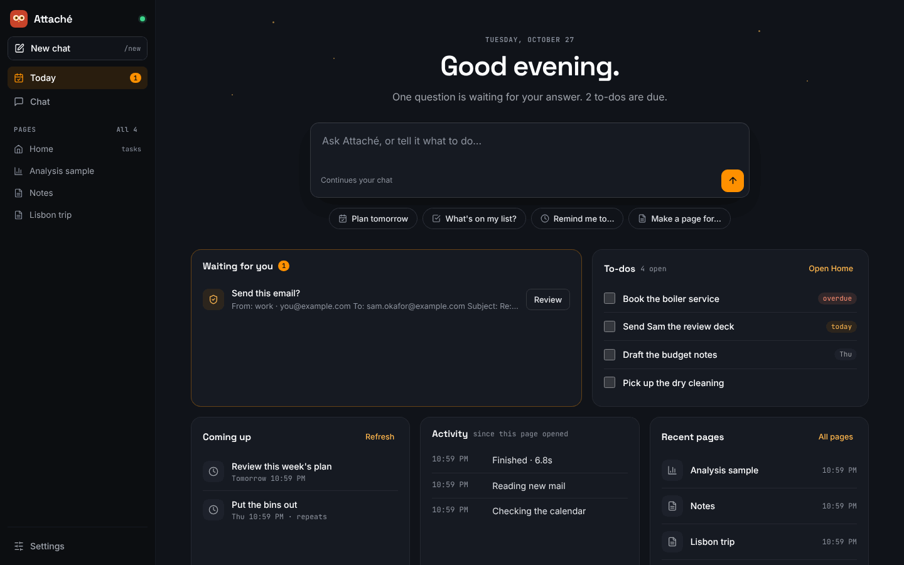

# Web workspace

The web page and terminal share your conversation. Open the link Attaché prints when it
starts. The sidebar on the left holds everything: **Today**, **Chat**, your pages and
**Settings**. A page opens beside whichever view you are in, so you can read a trip plan
while you chat, or tick off to-dos next to Today.

## Today

Attaché opens on **Today**. It shows the date, how many questions are waiting for your
answer, and a message box. What you type there goes into the same chat as everything else,
and the page switches to **Chat** to show the reply. The suggestions below the box fill it
in for you to finish.

Underneath, Today gathers what needs you:

- **Waiting for you** lists the questions Attaché is waiting on, such as a mail approval.
  **Review** opens the question in the chat, where it shows in full and where you answer it.
  The number beside **Today** in the sidebar counts them.
- **To-dos** lists your open to-dos from the `todos` collection, soonest due first. Tick
  one to mark it done, as on the Home page. **Open Home** opens your tasks page beside Today.
- **Coming up** lists your next scheduled reminders. Use **Refresh** to see their current
  state; they also refresh every minute.
- **Activity** shows the steps of each turn since this browser page opened. It is not a
  complete history.
- **Recent pages** lists the pages changed most recently.

## Chat

Your messages show on the right; Attaché's replies show beside its owl. Replies show their
Markdown formatted: headings, lists and checklists, tables, quotes, code and links. Any HTML
in a reply shows as typed, and an image shows as a link to it, so nothing in the chat loads
from the internet. Your own messages also show as typed.

Questions that wait for your answer, such as a mail approval, appear as a card with one
button per answer. They show exactly as written, without formatting, so you approve what you
see; a long one, such as an email's preview, shows in a fixed-width font. The first answer
counts.

While Attaché works, a card lists each step as it finishes, the time so far, and a dimmed
line of the model's thinking (hover for all of it). **Stop**, or Esc, stops the turn. When
the reply comes, a footer gives its time, tokens and model. If a reply arrives while you are
in another view, a dot appears beside **Chat**.

**New chat**, at the top of the sidebar, starts the conversation afresh, as typing `/new`
does. A running turn stops first. The chat clears on every open page, and Attaché no longer
sees the earlier messages, though they are still kept. See
[Start a new chat](quickstart.md#start-a-new-chat).

## Pages

The sidebar lists your pages, the tasks page first and then the most recently changed.
Choose one to open it beside the current view, or follow a page link in a reply. Drag the
divider to give either side more room, or focus it and use the left and right arrow keys.
The page's own buttons:

- **Reload** loads a fresh copy; reloading can discard unsaved entries in the page. When
  Attaché updates a loaded page, the button changes to **Updated — reload** and a dot
  appears beside the page in the sidebar, leaving your current entries intact until you
  reload.
- The house button makes this page your tasks page: **Open Home** on Today opens it, and it
  stays first in the sidebar. Attaché picks a page named `home`, `todo` or `tasks` until you
  choose.
- The expand button gives the page the whole window. Choose a view in the sidebar to put it
  back beside that view.
- The close button hides the page. It stays loaded, with any unfinished entries, until you
  reload it or the browser page.

**All** beside the Pages heading lists every page, with saved analyses on their own. For
notebook-based work, see [Analysis](analysis.md): the live notebook opens separately, so
generated pages keep their sandbox.

## Settings

**Settings** lets the owner inspect and edit supported configuration values. Forms and an
advanced TOML view edit the same settings. Review the proposed changes before saving; the
server validates the configuration and checks that the file has not changed elsewhere.
See [Configuration](configuration.md) for the settings and restart behavior.

## Smaller windows

In a narrower window an open page takes the place of the view instead of sitting beside
it, and the sidebar shrinks to a column of icons. On a phone the icons run along the top,
and **Pages** lists your pages. Switching views keeps message drafts and loaded pages intact.

## Local preferences and access

The browser remembers your view, the open page, its width and your tasks page. If browser
storage is unavailable, everything still works for the current visit. The sign-in token in
the launch link changes when Attaché restarts; use the newly printed link after a restart.

Settings are part of the owner's local interface. Generated pages and public share links
cannot read or change them. Configuration changes are saved on disk and take effect when
Attaché next starts; saving does not interrupt an active conversation.
